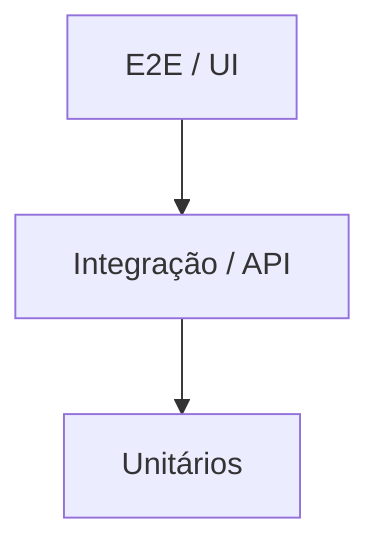

# Módulo 1 — Teoria de Automação de Testes

## 1. O que é automação de testes

Automação de testes é o uso de scripts/ferramentas para executar verificações
que, de outra forma, seriam feitas manualmente por uma pessoa: clicar em
botões, preencher formulários, conferir textos na tela, validar respostas de
API, etc.

O objetivo **não** é substituir o teste exploratório humano, e sim:

- Repetir verificações de regressão de forma rápida e consistente.
- Rodar em paralelo, em múltiplos ambientes/navegadores.
- Integrar com CI/CD, barrando deploys quebrados.
- Liberar tempo do time de QA para testes exploratórios e de maior valor.

## 2. Pirâmide de testes

- **Unitários**: testam uma função/classe isolada. Rápidos, baratos, muitos.
- **Integração / API**: testam a comunicação entre componentes (ex.: handler
  Go + banco, endpoint `/api/hats`). Mais lentos que unitários, ainda rápidos.
- **E2E / UI**: testam o fluxo completo pelo navegador, como um usuário real.
  Mais lentos, mais frágeis, devem ser em menor quantidade — cobrindo os
  fluxos críticos (login, compra, checkout), não cada variação de regra de
  negócio.

No Hat Store isso se traduz em:

| Camada | Exemplo no projeto |
|--------|--------------------|
| Unitário | `backend/handlers/*_test.go`, `frontend/js/*.test.js` |
| API | Chamadas a `/api/hats`, `/api/login`, `/api/pedidos` via Playwright (`request` context) |
| E2E / UI | Buscar chapéu, filtrar por categoria/preço, login, checkout completo |

## 3. Tipos de teste que a automação pode cobrir

- **Funcional**: o sistema faz o que deveria (ex.: cupom `HATOFF` aplica 25% de desconto).
- **Regressão**: features antigas continuam funcionando após mudanças novas.
- **Contrato/API**: a resposta de um endpoint mantém o formato esperado (schema).
- **Visual**: a tela não teve uma quebra de layout inesperada (screenshot diff).
- **Não-funcional** (fora do escopo deste curso, mas bom saber que existem):
  performance, carga, segurança, acessibilidade.

## 4. Quando automatizar (e quando não)

Automatizar vale a pena quando o cenário é:

- **Repetitivo** — vai rodar em toda regressão/release.
- **Estável** — a tela/fluxo não muda toda semana.
- **De alto risco de negócio** — login, checkout, pagamento.

Evite automatizar (ou automatize por último):

- Telas ainda em constante mudança de design/fluxo.
- Casos extremamente raros, exploratórios ou "que só um humano percebe"
  (ex.: "o botão parece deslocado 2px").
- Cenários que exigem julgamento visual/UX subjetivo.

## 5. Test flakiness (testes instáveis)

Um teste é **flaky** quando passa e falha de forma inconsistente, sem
mudança no código. Causas comuns:

- Esperar tempo fixo (`sleep`) em vez de esperar uma condição real.
- Depender de dados de outro teste (ordem de execução, banco compartilhado).
- Seletores frágeis (texto/posição) que mudam com pequenas alterações de UI.
- Ambiente instável (rede, containers subindo lentamente).

O Playwright ataca a maior parte desse problema nativamente com
**auto-waiting** e **web-first assertions** (módulo 2), mas a estratégia de
dados e isolamento de teste continua sendo responsabilidade de quem escreve
o teste.

## 6. Massa de dados e isolamento

Boas práticas:

- Cada teste deve poder rodar **sozinho**, sem depender de outro ter rodado antes.
- Prefira gerar dados únicos por execução (ex.: e-mail com timestamp/UUID no
  cadastro do Hat Store) em vez de reutilizar um usuário fixo que pode já
  existir no banco.
- Separe massa de dados fixa (chapéus do catálogo, cupom `HATOFF`) de massa
  dinâmica (usuário novo a cada teste).

## 7. Métricas básicas de uma suíte de testes

- **Cobertura de fluxo crítico**: os principais fluxos de negócio têm teste? (login, busca, checkout)
- **Tempo de execução**: a suíte roda rápido o suficiente para rodar a cada PR?
- **Taxa de flakiness**: quantos re-runs são necessários para a suíte passar?
- **Manutenibilidade**: quando a UI muda, quantos arquivos precisam ser tocados?
  (Page Object Model, módulo 2, existe para reduzir esse número.)

## Exercício

Antes de ir para o módulo 2, liste por escrito (sem código ainda):

1. Quais 3 fluxos do Hat Store você automatizaria primeiro, e por quê?
2. Um fluxo do Hat Store que você **não** automatizaria agora — justifique.
3. Um exemplo de dado que precisa ser único a cada execução de teste (dica: cadastro de usuário).

## Material de apoio

- Slides originais da aula 1 (estratégia de automação): ver
  [README do repositório de aulas](https://github.com/galaschi/start-aula-playwright).
- Documentação oficial do Playwright: https://playwright.dev/docs/intro

Próximo módulo: [02 — Fundamentos do Playwright](../02-fundamentos-playwright/README.md)
