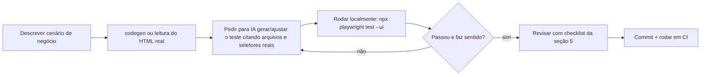

# Módulo 3 — Boas Práticas de IA aplicada ao Playwright

Ferramentas de IA (Copilot, Claude, ChatGPT etc.) aceleram muito a escrita de
testes Playwright, mas **quem responde pela qualidade da suíte continua
sendo a pessoa que revisa e roda o teste** — não a IA. Este módulo cobre como
usar IA como acelerador, não como piloto automático.

## 1. Onde a IA ajuda de verdade

- Gerar o **esqueleto** de um teste ou Page Object a partir de uma descrição.
- Sugerir locators alternativos quando um seletor está frágil.
- Explicar um erro de execução (stack trace, timeout, trace viewer).
- Refatorar testes duplicados em fixtures/helpers.
- Gerar dados de teste (massa) realistas (nomes, CPFs válidos para o Hat Store, e-mails únicos).
- Traduzir um cenário em Gherkin/linguagem natural para código Playwright.

## 2. Onde a IA erra com frequência (e por quê)

- **Locators inventados**: a IA pode sugerir `page.locator('#btn-login')`
  sem esse `id` existir no HTML real — ela não "vê" a página, a menos que
  você forneça o HTML/DOM ou use uma ferramenta com acesso ao navegador.
- **Esperas erradas**: sugerir `page.waitForTimeout(3000)` em vez de uma
  espera baseada em condição (`expect(...).toBeVisible()`). Isso reintroduz
  flakiness e testes lentos.
- **Assumir estrutura genérica**: a IA tende a gerar testes "de curso" (ex.:
  `#username`, `#password` genéricos) que não batem com o app real.
- **Excesso de mocks**: para "fazer passar", a IA pode sugerir mockar a
  resposta da API em vez de testar a integração real — bom em unitário, ruim
  quando o objetivo é E2E.

## 3. Boas práticas de prompt para gerar testes Playwright

Um prompt melhor **cita fatos verificáveis do próprio código**, não pede
para a IA "adivinhar" a aplicação:

Prompt fraco:
> "Cria um teste de login pro meu site."

Prompt melhor:
> "No arquivo `frontend/auth.html`, o formulário de login tem
> `#login-email`, `#login-password` e um botão `Entrar` do tipo submit.
> Gere um teste Playwright em `tests/login.spec.js` que preenche esses
> campos com um usuário válido e verifica que `#auth-links` passa a exibir
> o nome do usuário logado, usando o `LoginPage` já existente em
> `pages/LoginPage.js`."

Diferenças: cita arquivo real, seletores reais, page object existente e o
critério de sucesso esperado (o que muda na tela após login).

## 4. Use ferramentas que "enxergam" a aplicação

Sempre que possível, prefira:

- **`npx playwright codegen <url>`**: grava suas interações reais no
  navegador e gera o código de locators corretos — ótimo ponto de partida
  para revisar/ajustar com IA depois, em vez de pedir pra IA "chutar" seletores.
- **Trace viewer / relatório HTML**: cole o erro real (mensagem + snippet do
  DOM) na IA ao pedir ajuda de debug, em vez de descrever de memória.
- **MCP do Playwright** (quando disponível no seu editor): permite que o
  agente de IA controle um navegador real, leia o DOM/acessibilidade da
  página, e gere seletores baseados no que realmente existe — reduz muito o
  problema de "locator inventado".

## 5. Checklist de revisão de teste gerado por IA

Antes de aceitar um teste gerado (ou editado) por IA, confira:

- [ ] Os seletores existem de fato no HTML/componente (`grep`/DevTools/`codegen`).
- [ ] Não há `waitForTimeout` sem justificativa — prefira esperar por uma condição.
- [ ] O teste roda **isolado** (não depende de outro teste ter rodado antes).
- [ ] Dados sensíveis (senha, CPF, token) não estão hardcoded em texto plano
      versionado além do necessário para dados de teste fictícios.
- [ ] O teste falha de verdade quando o comportamento quebra (rode uma vez
      "quebrando" a feature de propósito, para confirmar que o teste pega).
- [ ] Nome do teste e mensagens de assert são claros para quem for debugar depois.

## 6. Segurança e IA

- Nunca cole segredos reais (senhas de produção, tokens, `.env`) em um
  prompt de IA — nem local nem em serviços de nuvem.
- Dados de teste (CPF, e-mail, cartão) devem ser sempre fictícios/gerados,
  nunca dados reais de clientes.
- Se a IA sugerir desabilitar validações de segurança "pra passar o teste"
  (ex.: ignorar HTTPS, desabilitar CORS, pular verificação de JWT), trate
  isso como um alerta — o objetivo do teste é validar o comportamento real,
  não contornar a segurança da aplicação.

## 7. Fluxo de trabalho recomendado (IA + Playwright)

## Exercício

1. Escolha um fluxo do Hat Store ainda sem teste (ex.: aplicar cupom
   `HATOFF` no carrinho).
2. Escreva um prompt seguindo a seção 3, citando o arquivo/seletor real
   (veja `frontend/js/app.js`, função `aplicarCupom`).
3. Gere o teste com IA, rode localmente e passe pelo checklist da seção 5
   antes de considerá-lo pronto.

Módulo anterior: [02 — Fundamentos do Playwright](../02-fundamentos-playwright/README.md)
Volta ao índice: [README do curso](../README.md)
